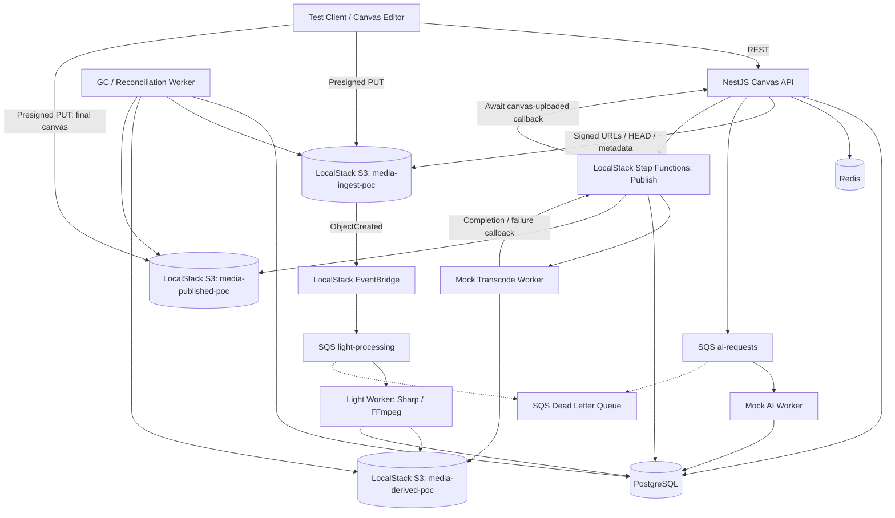
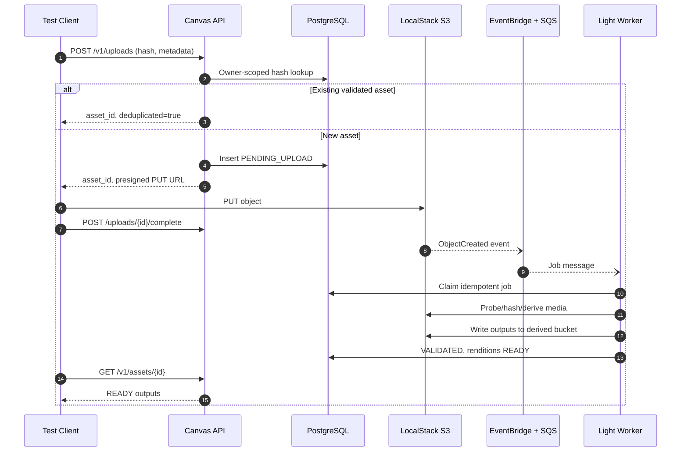
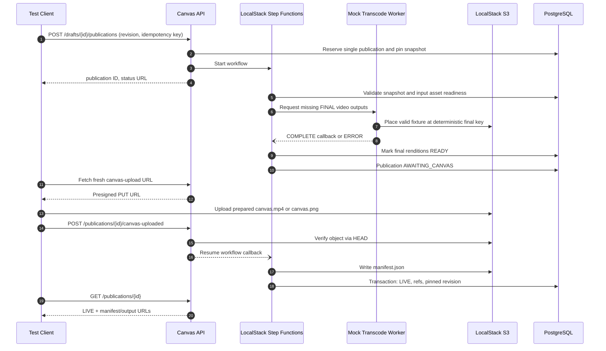
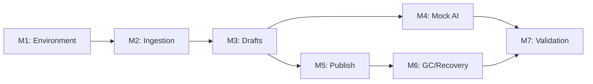

# Canvas Editor Media Platform — LocalStack POC Plan

**Document type:** Proof of Concept — Scope, Milestones, and Engineering Backlog  
**Date:** 23 October 2026  
**Status:** Proposed for implementation  
**Target environment:** LocalStack + Docker Compose (no AWS account)  
**Backend:** NestJS, PostgreSQL, Redis  
**Media processing:** Sharp + FFmpeg (light processing); mock transcode service (final video processing)  
**Source:** *Canvas Editor Media Platform — System Design* (23 October 2026)

---

## 1. Executive summary

Build a **fully local, end-to-end POC** proving the Canvas Editor media lifecycle: upload media, process draft-ready derivatives, create and revise canvas drafts, generate mocked AI layouts, publish an immutable revision, and safely garbage-collect unreferenced media.

The POC preserves the source design's **hybrid processing architecture**:

- **At upload:** Validate assets and produce low-cost previews, thumbnails, video proxies, and sprite sheets.
- **While editing:** Store canvas JSON revisions only; do **not** reprocess unchanged media.
- **At publish:** Produce final media renditions **only when needed**, using a **mock MediaConvert replacement** for videos.
- **For canvas composition:** The frontend (or a test client) uploads the final rendered canvas via a presigned S3 URL. **No server-side canvas composition.**
- **At cleanup:** Delete media only after database references are released and configurable grace periods elapse.


### Explicit constraints

1. **Do not use AWS accounts or AWS-managed services.** LocalStack emulates S3, SQS, EventBridge, and Step Functions where supported; PostgreSQL, Redis, and workers run in local containers.
2. **Do not use AWS Elemental MediaConvert.** A mock asynchronous transcoder replaces its job submission, status updates, completion/error events, and final-output delivery.
3. **No real AI model required.** A mock AI worker returns deterministic, schema-valid canvas JSON layouts.
4. **No full editor required for backend validation.** A minimal test client or scripted harness can upload a prepared `canvas.mp4` / `canvas.png` in place of an interactive Canvas/WebGL render.
5. **No production CloudFront, IAM/KMS, real Lambda/Fargate deployment, or production-scale video processing required.**


### Success definition

A developer can run a single setup command, upload test images/videos, edit and restore drafts without repeated processing, publish one immutable snapshot using an asynchronous mocked workflow, and safely delete unreferenced objects while referenced or published assets remain intact.

---


## 2. Architecture




**Important:** This is a logical architecture. Exact LocalStack routing and Step Functions callback features must be smoke-tested in **M1** against the selected LocalStack image/license. If an emulation feature is unavailable, record the deviation and use a container-based equivalent while preserving the same API, event payloads, and state transitions.

### Responsibility matrix


| Component            | POC implementation                          | Responsibility                                                             |
| -------------------- | ------------------------------------------- | -------------------------------------------------------------------------- |
| Client               | Minimal web page / scripts / API collection | Uploads, draft edits, publish requests, final canvas upload                |
| Canvas API           | NestJS container                            | Assets, presigning, dedup, drafts, revisions, references, publication APIs |
| DB                   | Docker PostgreSQL                           | Durable source of truth for all entities, jobs, outbox, retention          |
| Status / locks       | Docker Redis                                | Ephemeral status cache, publish locks if needed                            |
| Object storage       | LocalStack S3                               | Ingest, derived, published buckets                                         |
| Event routing        | LocalStack EventBridge and SQS              | Object-created routing, queues, retries, DLQs                              |
| Light worker         | Docker service using Sharp and FFmpeg       | Probe, verify, thumbnail, preview, proxy, poster, sprite outputs           |
| Mock AI              | Docker service                              | Asynchronous layout JSON generation and caching                            |
| Publish orchestrator | LocalStack Step Functions                   | Wait, fan-out, retries, final canvas gate, manifest, LIVE state            |
| Mock transcoder      | Docker service                              | Asynchronous final-video job simulation and deterministic output           |
| GC / reconciler      | Docker service / scheduled CLI              | Cleanup, expiration, recovery, missing event detection                     |


---


## 3. Milestone plan

**Estimated engineering effort:** 38 person-days (planning estimate), plus QA/review time as allocated.  
**Indicative elapsed timeline:** 4–5 weeks with two developers, allowing parallel development and integration buffers. Re-estimate after the LocalStack integration spike.


| Milestone | Name                               | Est. person-days | Dependencies      | Exit criteria                                                                      |
| --------- | ---------------------------------- | ---------------- | ----------------- | ---------------------------------------------------------------------------------- |
| M1        | Local environment and data model   | 3                | None              | One-command stack boot; S3/SQS/EventBridge/Step Functions integration smoke tests  |
| M2        | Upload and light processing        | 8                | M1                | Image/video upload produces validated draft-ready media; duplicate work suppressed |
| M3        | Drafts, revisions, and references  | 6                | M1, M2 interfaces | Draft edit creates JSON revisions only; reference tracking correct                 |
| M4        | Mock AI layouts                    | 3                | M2, M3            | Layout request returns valid JSON and can become a revision                        |
| M5        | Publish and mock transcode         | 9                | M2, M3            | Exact snapshot publishes to LIVE; duplicate publish does not duplicate work        |
| M6        | Cleanup and recovery               | 5                | M3, M5            | Orphan cleanup safe under concurrent use; failures recoverable                     |
| M7        | Integration validation and handoff | 4                | All above         | Automated scenarios, demo, runbook, documentation complete                         |
| **Total** |                                    | **38**           |                   |                                                                                    |


**Suggested delivery gates:**

- **Gate A (M1–M2):** Media enters local storage and asynchronously produces draft-tier derivatives.
- **Gate B (M3):** Media can be shared among drafts and revisions without reprocessing.
- **Gate C (M4–M5):** Mock AI generates layouts and a publish operation transitions to LIVE.
- **Gate D (M6–M7):** Cleanup, failure handling, integration tests, and reproducibility validated.

---


## 4. Engineering backlog


### M1 — LocalStack environment and database foundations

**Estimate:** 3 person-days  
**Priority:** P0  
**Deliverable:** Working local stack + bootstrap scripts + migrations.


| Ticket      | Task                                                                                                                                            | Acceptance criteria                                                                                          |
| ----------- | ----------------------------------------------------------------------------------------------------------------------------------------------- | ------------------------------------------------------------------------------------------------------------ |
| **POC-001** | Create `docker-compose.yml` for LocalStack, PostgreSQL, Redis, Canvas API, and worker containers                                                | All services become healthy; local development endpoints documented                                          |
| **POC-002** | Bootstrap S3 buckets: `media-ingest-poc`, `media-derived-poc`, `media-published-poc`                                                            | PUT / HEAD / GET / DELETE work against LocalStack                                                            |
| **POC-003** | Provision `light-processing`, `ai-requests`, and related DLQs; verify S3 → EventBridge → SQS delivery                                           | Uploading an object under the staging prefix reaches the intended queue; retry and DLQ behavior smoke-tested |
| **POC-004** | Implement PostgreSQL migrations for drafts, revisions, assets, renditions, references, processing jobs, publications, AI generation, and outbox | Schema initializes on a clean database with unique constraints and indexes                                   |
| **POC-005** | Add bootstrap/teardown commands, environment config, health checks, and Step Functions compatibility smoke test                                 | Fresh clone can start services and verify working connectivity without using AWS credentials                 |


**M1 exit demo:** Run one command to start all services and show a test S3-created event arriving on SQS.

### M2 — Media ingestion and draft-tier processing

**Estimate:** 8 person-days  
**Priority:** P0  
**Deliverable:** Presigned upload → event → worker → READY renditions.


| Ticket      | Task                                                                                            | Acceptance criteria                                                                               |
| ----------- | ----------------------------------------------------------------------------------------------- | ------------------------------------------------------------------------------------------------- |
| **POC-006** | Implement `POST /v1/uploads` with owner-scoped SHA-256 dedup and upload reservation             | New upload returns `asset_id` and presigned URL; repeated validated content reuses existing asset |
| **POC-007** | Implement upload-complete confirmation and object HEAD verification                             | `PENDING_UPLOAD → UPLOADED` only after object verified                                            |
| **POC-008** | Integrate S3 ObjectCreated notifications with EventBridge → SQS → light worker                  | New uploads cause processing automatically; duplicate events remain safe                          |
| **POC-009** | Validate file type/limits, extract metadata, and recompute SHA-256 server-side                  | Invalid/corrupt files become `REJECTED`; fake client hashes are detected                          |
| **POC-010** | Generate image thumbnail and WebP preview with Sharp                                            | Rendition rows become `READY`; outputs exist at deterministic keys                                |
| **POC-011** | Generate video poster, low-res proxy, sprite sheets, and `sprite.json` using FFmpeg             | All expected draft-tier outputs are accessible; frames/timestamps are described in metadata       |
| **POC-012** | Implement job idempotency, leases, attempt counts, error state, SQS redelivery and DLQ handling | Duplicate SQS messages cannot create duplicate processing; retryable failure behaves predictably  |
| **POC-013** | Implement `GET /v1/assets/{assetId}` and status aggregation                                     | Client can poll upload/processing states and obtain ready rendition URLs                          |


**M2 exit demo:** Upload **5 images + 1 video**. All six become usable in drafts. **No final-tier transcode** is executed.

### M3 — Drafts, revisions, and asset references

**Estimate:** 6 person-days  
**Priority:** P0  
**Deliverable:** Editable canvas documents with immutable history, optimistic locking, and safe reference retention.


| Ticket      | Task                                                                           | Acceptance criteria                                                                          |
| ----------- | ------------------------------------------------------------------------------ | -------------------------------------------------------------------------------------------- |
| **POC-014** | Implement draft create/read/list endpoints                                     | New draft can be retrieved with current revision                                             |
| **POC-015** | Store canvas documents as immutable JSONB revision snapshots                   | Revision sequence increments on change; unchanged document does not add a redundant revision |
| **POC-016** | Require `base_revision` and apply optimistic concurrency checks                | Conflicting stale save returns `409 REVISION_CONFLICT`                                       |
| **POC-017** | Extract `asset_id` values from each new revision; create revision references   | Exact revision-to-asset usage recorded transactionally                                       |
| **POC-018** | Recalculate `ref_count`, `retention_status`, and `orphaned_at` from references | An asset shared by multiple holders is not orphaned prematurely                              |
| **POC-019** | Implement revision restore, draft soft-discard and draft restore               | An older snapshot is recovered without uploading or processing assets again                  |


**M3 exit demo:** Edit the same draft 20 times. No new media-processing jobs occur. Restore an earlier revision and retain its media.

### M4 — Mock AI layout service

**Estimate:** 3 person-days  
**Priority:** P1  
**Deliverable:** Async mock layout generation, cache, and draft integration.


| Ticket      | Task                                                                                 | Acceptance criteria                                                                               |
| ----------- | ------------------------------------------------------------------------------------ | ------------------------------------------------------------------------------------------------- |
| **POC-020** | Implement deterministic mock layout generation using supplied asset IDs and metadata | Response conforms to canvas JSON schema and cannot reference unknown assets                       |
| **POC-021** | Add AI request SQS worker, job records, and result polling                           | `QUEUED → PROCESSING → READY/FAILED` observable via API                                           |
| **POC-022** | Cache by input hash + model version + seed; implement save-to-revision flow          | Repeated identical requests reuse cached layout; accepted result becomes `AI_GENERATION` revision |


**M4 exit demo:** Request an AI layout twice and show no redundant media work and cached generation result.

### M5 — Publish pipeline with mock MediaConvert replacement

**Estimate:** 9 person-days  
**Priority:** P0  
**Deliverable:** Publish orchestration to `LIVE`, with no real MediaConvert.


| Ticket      | Task                                                                                                                | Acceptance criteria                                                                               |
| ----------- | ------------------------------------------------------------------------------------------------------------------- | ------------------------------------------------------------------------------------------------- |
| **POC-023** | Implement mock transcode contract and asynchronous worker                                                           | Receives job payload; simulates `QUEUED/RUNNING/COMPLETE/ERROR`, configurable latency and failure |
| **POC-024** | Create final rendition rows and deterministic derived keys; reuse READY results                                     | Existing outputs bypass mock job; missing final outputs are produced                              |
| **POC-025** | Implement Step Functions publish state machine with fan-out, wait states, retries, and callbacks                    | Execution waits for assets and mock transcoder outcomes; traceable state transitions              |
| **POC-026** | Implement `POST /v1/drafts/{id}/publications`, request idempotency, single-publication constraint, snapshot pinning | Double-click same key returns same operation; conflicting publish cannot create another           |
| **POC-027** | Add `AWAITING_CANVAS` gate and presigned upload URL                                                                 | Workflow waits for test client's canvas upload confirmation                                       |
| **POC-028** | Implement `/v1/publications/{id}/canvas-uploaded`, verify canvas object, and write manifest                         | Manifest contains frozen revision, render object, and final rendition map                         |
| **POC-029** | Transactionally mark `LIVE`, pin revision and create `PUBLICATION` media references                                 | Published assets cannot be GC-deleted; publication points to exact immutable revision             |
| **POC-030** | Implement retry, timeout, and failed-publication recovery                                                           | Successful renditions are reused; missing/failed work retried without duplicate publication       |


#### Mock transcode service contract

Example request:

```json
{
  "job_id": "uuid",
  "publication_id": "uuid",
  "asset_id": "uuid",
  "source_bucket": "media-ingest-poc",
  "source_key": "originals/owner/hash/source.mp4",
  "output_bucket": "media-derived-poc",
  "output_key": "assets/owner/hash/final/v1/mp4_1080p_t0-15000.mp4",
  "rendition_kind": "FINAL_MP4_1080",
  "recipe_version": 1,
  "clip": { "start_ms": 0, "end_ms": 15000 },
  "simulate": { "delay_ms": 2500, "result": "COMPLETE" }
}
```

**Required mock behavior:**

1. Validate request shape and register an idempotent job.
2. Publish or expose transitions `QUEUED → RUNNING → COMPLETE` or `ERROR`.
3. On success, place a **valid test media fixture** at the requested output key. Do not represent a copied fixture as evidence of real transcoding or clipping.
4. Send a completion/failure event or task-token callback understood by the publish orchestrator.
5. Support deterministic test modes: success, transient failure, permanent failure, delayed completion, duplicate callback, and timeout.
6. Leave completed renditions in storage when a later publish stage fails so retries can reuse them.

**M5 exit demo:** Publish one draft containing images and video. Mock final renditions complete, the client uploads a prepared canvas file, `manifest.json` appears in `media-published-poc`, and the publication enters `LIVE`.

### M6 — Garbage collection, recovery and reconciliation

**Estimate:** 5 person-days  
**Priority:** P0  
**Deliverable:** Reference-aware cleanup that never deletes live assets.


| Ticket      | Task                                                                          | Acceptance criteria                                                                  |
| ----------- | ----------------------------------------------------------------------------- | ------------------------------------------------------------------------------------ |
| **POC-031** | Expire pending uploads and mark unattached assets eligible for cleanup        | Expired uploads and unattached assets transition according to configurable policies  |
| **POC-032** | Prune old unpinned revisions and purge discarded drafts                       | Reference rows released; published/pinned snapshots preserved                        |
| **POC-033** | Implement mark-and-sweep GC: `ORPHANED → DELETING → DELETED` using DB locks   | Deletes ingest + derived objects only after grace-period and zero-reference re-check |
| **POC-034** | Protect actively referenced assets and jobs in progress                       | GC does not delete during ongoing processing or a concurrent save/restore            |
| **POC-035** | Add retry/redrive and lease-timeout handling for failed or stuck jobs         | DLQ and stuck-job scenarios are diagnosable and recoverable                          |
| **POC-036** | Implement reconciliation for missed object events and DB/object-storage drift | Stuck `PENDING_UPLOAD` and unexpected stray objects are detected and handled safely  |


**M6 exit demo:** Configure short grace periods (minutes), discard a draft, run GC, and prove that only unreferenced media are deleted; assets shared by other drafts or publications remain intact.

### M7 — Integration tests, demo, and handoff

**Estimate:** 4 person-days  
**Priority:** P0  
**Deliverable:** A reproducible, reviewed POC.


| Ticket      | Task                                                                                | Acceptance criteria                                                           |
| ----------- | ----------------------------------------------------------------------------------- | ----------------------------------------------------------------------------- |
| **POC-037** | Implement integration tests for upload, draft, AI, publish, and cleanup             | Core lifecycle transitions covered with assertions and repeatable fixtures    |
| **POC-038** | Test duplicates, concurrency, queue retry, worker crash, mock failure and GC races  | No duplicate processing, broken references, or inconsistent publication state |
| **POC-039** | Create one-command or scripted end-to-end demonstration                             | Entire flow executes using a fresh database and LocalStack environment        |
| **POC-040** | Write developer README, API collection, architecture deviations and failure runbook | Another engineer can run, troubleshoot, and verify the POC independently      |


---


## 5. APIs in POC scope


| Method | Route                                      | Milestone | Purpose                                      |
| ------ | ------------------------------------------ | --------- | -------------------------------------------- |
| POST   | `/v1/uploads`                              | M2        | Start upload, dedup, presign                 |
| POST   | `/v1/uploads/{assetId}/complete`           | M2        | Confirm completed upload                     |
| GET    | `/v1/assets/{assetId}`                     | M2        | Upload/rendition state                       |
| POST   | `/v1/drafts`                               | M3        | Create draft                                 |
| GET    | `/v1/drafts/{id}`                          | M3        | Draft and head revision                      |
| PUT    | `/v1/drafts/{id}`                          | M3        | Save immutable revision with `base_revision` |
| GET    | `/v1/drafts/{id}/revisions`                | M3        | Revision list                                |
| POST   | `/v1/drafts/{id}/revisions/{rev}/restore`  | M3        | Restore snapshot as new revision             |
| DELETE | `/v1/drafts/{id}`                          | M3        | Soft-discard                                 |
| POST   | `/v1/drafts/{id}/restore`                  | M3        | Restore soft-discarded draft                 |
| POST   | `/v1/drafts/{id}/ai-layouts`               | M4        | Request mock AI layout                       |
| GET    | `/v1/ai-layouts/{genId}`                   | M4        | Poll generated layout                        |
| POST   | `/v1/drafts/{id}/publications`             | M5        | Publish exact revision                       |
| GET    | `/v1/publications/{pubId}`                 | M5        | Publication state, output references         |
| POST   | `/v1/publications/{pubId}/canvas-uploaded` | M5        | Confirm frontend-rendered canvas upload      |
| GET    | `/v1/drafts/{id}/status`                   | M5        | Asset + publication roll-up for test client  |


**Out of POC API scope:** Full WebSocket push, production CDN URL signing, and sophisticated multipart-resume UX. Polling is acceptable for the demonstration. Multipart may be introduced later if test fixtures require it.

---


## 6. Core database entities and state machines


### Core tables

- `canvas_draft`: owner, status, head revision, activity and discard timestamps.
- `canvas_revision`: immutable canvas JSON, revision number, source and pinned flag.
- `media_asset`: original object, checksum, metadata, upload state, retention state.
- `media_rendition`: asset-specific derivative kind, recipe version, deterministic S3 key, status.
- `media_reference`: authoritative mapping from revision/publication to asset.
- `processing_job`: idempotency key, type, attempts, lease, status and error.
- `publication`: exact revision, immutable publication identity, status, render/manifest keys.
- `publication_asset`: final rendition mappings per publication.
- `ai_generation`: generation request, cache identity, result and status.
- `outbox_event`: durable events emitted alongside transactional state changes.


### State model


| Object      | States to support                                                                                       |
| ----------- | ------------------------------------------------------------------------------------------------------- |
| Upload      | `PENDING_UPLOAD → UPLOADED → VALIDATED` or `REJECTED`; `EXPIRED` for abandoned uploads                  |
| Rendition   | `NOT_REQUESTED → QUEUED → PROCESSING → READY` or `FAILED` / `FAILED_PERMANENT`                          |
| Retention   | `UNATTACHED`, `REFERENCED`, `PUBLISHED`, `ORPHANED`, `DELETING`, `DELETED`                              |
| Publication | `REQUESTED → WAITING_FOR_ASSETS → TRANSCODING → AWAITING_CANVAS → FINALIZING → LIVE`; `FAILED` on error |
| Draft       | `ACTIVE`, `PUBLISHING`, `PUBLISHED`, `DISCARDED`, optionally `DORMANT` / `PURGED`                       |


**POC policy decision:** A draft can be published only once. The published revision is frozen; further editing/republishing of that draft is rejected. An edit attempt while that draft is `PUBLISHING` is also rejected. The source design contains conflicting language about edit-after-publish and editing during publication; this POC uses the stricter one-publication-per-draft rule consistently.

---


## 7. End-to-end flows


### 7.1 Upload and light processing




### 7.2 Draft editing

1. Create draft.
2. Save JSON canvas document with list of `asset_id` references and `base_revision`.
3. API atomically creates a revision and corresponding `media_reference` rows.
4. Unchanged document is not saved twice.
5. Conflicting `base_revision` returns 409.
6. Restore an old revision by creating a **new head revision**, not by mutating a past one.
7. **No media job** starts because of a canvas edit.


### 7.3 Publish with mock video processing




### 7.4 Garbage collection

1. Mark expired uploads, discard/purge drafts, and prune eligible unpinned revisions.
2. Recompute media references and transition zero-reference assets to `ORPHANED`.
3. After grace period, claim candidates with PostgreSQL locking and skip those with running jobs.
4. Check the absence of references again before changing `ORPHANED → DELETING`.
5. Delete original and all derivative objects, then write the `DELETED` tombstone.
6. If object deletion partially fails, leave `DELETING` and retry on subsequent runs.
7. Reject new references to `DELETING` / `DELETED` assets to close GC/save races.

---


## 8. Validation checklist (required demonstrations)

- [ ] **Upload mix:** Upload five images plus one video; all six validated; draft-tier renditions READY; zero final video jobs.
- [ ] **Owner-scoped dedup:** Upload same bytes twice for same owner; only one active asset and one set of processing outputs.
- [ ] **Edit without processing:** Save 20 changed draft revisions; no new media-processing jobs.
- [ ] **Optimistic concurrency:** Two tabs save against same base revision; second conflicting save returns HTTP 409.
- [ ] **Mock AI:** AI layout references only known assets, repeats are cached, accepted result creates revision.
- [ ] **Publish:** Mock finals complete, client uploads final canvas, manifest created, publication LIVE.
- [ ] **Publish idempotency:** Same idempotency key and request return same publication; conflicting second publish rejected.
- [ ] **Mock failures:** Transient errors retry; permanent errors fail; READY outputs survive publication retries.
- [ ] **Cross-draft reuse:** Two drafts reference same asset; removing one draft does not delete it.
- [ ] **Discard and restore:** Recover a discarded draft within grace period without re-uploading files.
- [ ] **GC correctness:** Eligible orphan is removed; referenced/published media remain available.
- [ ] **GC/worker races:** Concurrent GC and save/restore never leave revisions pointing at deleted media.
- [ ] **Missed events:** Upload confirmation/reconciler recovers an upload whose ObjectCreated message was dropped.
- [ ] **Clean environment:** Entire demonstration runs again from a fresh Docker volume and clean LocalStack state.

**Test datasets:** Small PNG/JPEG/WebP images, short MP4 clip, one corrupt file, one large-enough sample to exercise configured limits, and one pre-rendered canvas fixture. All must be redistributable test content.

---


## 9. Nonfunctional checks and operating practices


| Concern         | POC requirement                                                                                    |
| --------------- | -------------------------------------------------------------------------------------------------- |
| Idempotency     | Unique job keys, deterministic output keys, HEAD-before-work, database constraints                 |
| Consistency     | DB transaction for revision creation, references, publication finalization, and outbox writes      |
| Recovery        | Job leases, retry attempts, DLQs, explicit reconciliation commands                                 |
| Debugging       | Structured logs with `asset_id`, `job_id`, `draft_id`, `publication_id`, correlation ID            |
| Status          | API polling is sufficient; distinguish upload, rendition, and publication state                    |
| Security        | Local-only service binding, fake credentials for LocalStack, owner checks on API requests          |
| Determinism     | Mock transcoder configurable delay, success, error, and duplicate outcome modes                    |
| Cost            | No AWS cloud charges; Docker compute/storage only (LocalStack licensing, if any, must be verified) |
| Reproducibility | Version-pinned Docker image tags and one-command provisioning                                      |


### Known limitations

- The mock transcoder demonstrates **orchestration**, **not output quality**, bitrate behavior, codecs, segment clipping accuracy, or MediaConvert economics.
- A prepared canvas file demonstrates the **backend upload and publish handshake**, not the browser/WebGL rendering quality.
- LocalStack behavior does not guarantee feature parity with AWS in production. Revalidate IAM, EventBridge rules, Step Functions callback integrations, retries, DLQ redrive, and S3 behavior during AWS migration.
- Storage load, large multipart video uploads, long-running Fargate processing, live WebSocket updates, and real AI quality are deferred.

---


## 10. Dependencies, roles, and timeline


### Recommended assignment


| Role                   | Primary ownership                                                                            | Can begin                         |
| ---------------------- | -------------------------------------------------------------------------------------------- | --------------------------------- |
| Backend developer A    | API, PostgreSQL schema/migrations, drafts, revisions, references, publish validation         | M1                                |
| Backend developer B    | LocalStack provisioning, queues/events, Sharp/FFmpeg worker, mock transcoder, Step Functions | M1                                |
| QA / integration owner | API fixtures, happy/negative tests, duplicate and race scenarios, demonstration script       | M1; progressively validates M2–M7 |


### Dependency chain




| Week            | Target outcome                                                   |
| --------------- | ---------------------------------------------------------------- |
| Week 1          | M1 complete; M2 upload + event path started                      |
| Week 2          | M2 complete; M3 in progress                                      |
| Week 3          | M3 complete; M4 and M5 proceeding in parallel                    |
| Week 4          | M4/M5 complete; M6 started                                       |
| Week 5 (buffer) | M6/M7 completed; end-to-end demo, defect fixes, and team handoff |


This schedule is indicative and assumes parallel engineering effort. **Milestone estimates are person-days, not elapsed days.**

---


## 11. Deliverables and handoff


| Deliverable       | Contents                                                                                |
| ----------------- | --------------------------------------------------------------------------------------- |
| Local stack       | Docker Compose, pinned LocalStack image, DB initialization, Redis, worker services      |
| Infra bootstrap   | Bucket/queue/event/state-machine provisioning and cleanup scripts                       |
| Canvas API        | NestJS project, validation, API routes, migrations                                      |
| Worker services   | Light processor, mock AI processor, mock final-video processor, GC/reconciler           |
| Test client       | Upload, draft, publish, status and canvas-upload test harness                           |
| Tests             | Integration and fault injection suites with fixtures                                    |
| Documentation     | README, API examples or collection, workflow diagrams, architecture deviations, runbook |
| POC demonstration | Repeatable script + pass/fail evidence for required checklist                           |


### Final POC acceptance gate

The POC can be signed off when **all mandatory validation checklist cases pass**, services start from a clean environment, and the team demonstrates the complete path:

```text
Upload / Dedup
    -> LocalStack S3
    -> EventBridge / SQS
    -> Light Processing (Sharp / FFmpeg)
    -> Draft JSON Revisions + Asset References
    -> Mock AI Layout (optional branch)
    -> Publish Exact Revision
    -> Mock FINAL Video Renditions + Final Image Renditions
    -> Client Uploads Rendered Canvas
    -> Manifest + Publication LIVE
    -> Discard / Orphan / Safe GC
```

**Next step after POC:** Replace LocalStack adapters with actual AWS services and the mock final-video adapter with MediaConvert, while preserving domain entities, job contracts, idempotency rules, reference tracking, and publish orchestration semantics.

---


## 12. Open questions and decisions log


| Topic                          | POC assumption / action                                                                       |
| ------------------------------ | --------------------------------------------------------------------------------------------- |
| LocalStack coverage            | Verify exact S3 → EventBridge → SQS and Step Functions integrations in M1; document fallbacks |
| Draft editing while publishing | **Reject edits** until publish completes or fails                                             |
| Editing after publish          | **Not allowed** for this POC; one publication per draft                                       |
| Per-owner dedup                | Deduplicate only within owner scope, not globally                                             |
| Orphan grace period            | Configurable; minutes for tests, longer policy defaults for production design                 |
| Canvas rendering               | Upload a prepared fixture from test client; no server-side composition                        |
| Final image transforms         | May use Sharp to create real final WebP images; video finals are mock fixtures                |
| UI updates                     | Poll API; defer WebSockets/SSE                                                                |
| Large video multipart          | Defer unless fixtures require it; validate standard presigned PUT first                       |


**Confidence level:** High for architecture coverage and milestone dependencies; medium for elapsed timeline until LocalStack support and team capacity are verified.