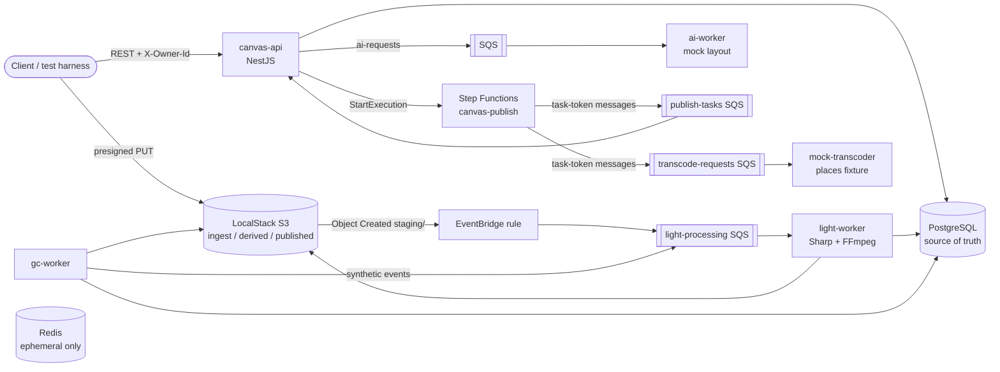
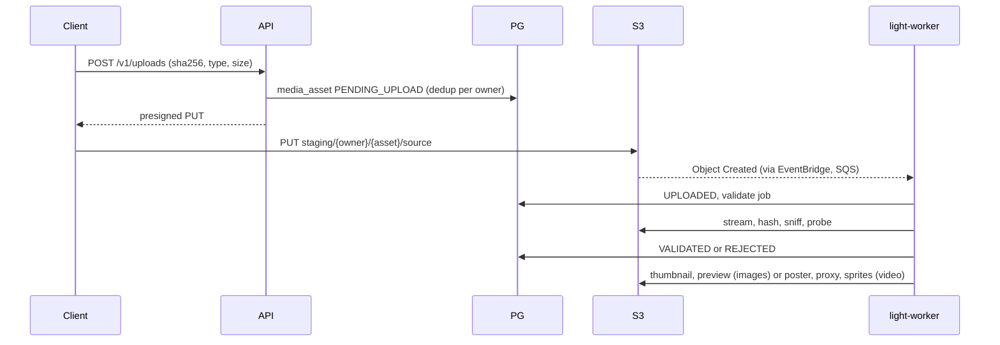
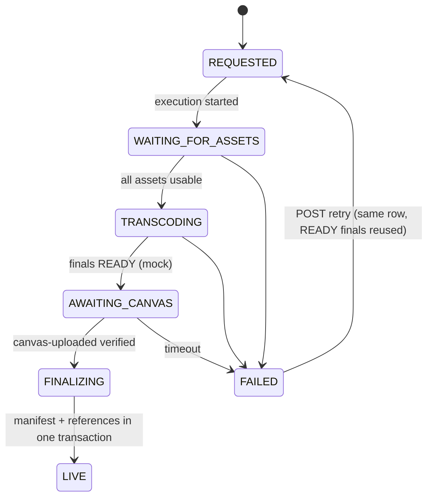

# Architecture and deviations

Source of truth for scope: [Canvas_Editor_Media_Platform_POC_Plan.md](../Canvas_Editor_Media_Platform_POC_Plan.md). This file shows how the running POC is wired and where it differs from the plan or from AWS.

## Components

Postgres holds every durable fact. Redis is provisioned but holds only ephemeral data. Workers claim jobs with a lease and heartbeat (`services/shared/job-repo.ts`) and every output key is deterministic, so a retry or duplicate message repeats nothing (HEAD before work).

## Flows

Upload and light processing:

Publish (one publication per draft; every workflow step is an SQS task-token message):

Garbage collection (`gc-worker`, one cycle under an advisory lock): reconcile missed uploads, expire uploads, purge discarded drafts, prune old revisions, mark unattached, sweep (`ORPHANED → DELETING → DELETED`), reap stuck jobs, requeue, report drift and strays. References decide everything: a row in `media_reference` (revision or publication) keeps an asset alive.

## Deviations from the plan and from AWS

| Topic | POC | Production |
| --- | --- | --- |
| Final video | `mock-transcoder` copies `fixtures/sample.mp4` to the deterministic final key. It does not transcode and says nothing about quality, codecs or bitrate. | AWS Elemental MediaConvert behind the same job contract |
| Step Functions tasks | LocalStack here has no Lambda. Every step is an `sqs:sendMessage.waitForTaskToken` message answered by a consumer (`canvas-api/src/publish/` runner, `mock-transcoder`). Same states and callbacks. | Lambda or service integrations |
| AI | Deterministic schema-valid layout from `services/shared/mock-layout.ts`. | Real model behind `ai-requests` |
| Canvas rendering | The client uploads the rendered canvas; nothing is composed server side. | Same |
| Final images | Images publish from the original; only videos get a final tier. | Final image transforms optional |
| Auth | `X-Owner-Id` header. | Real identity |
| GC schedule | Compose default is no timer (`GC_INTERVAL_SECONDS=0`, run `make gc-run`). | Scheduled |
| DLQ redrive | receive, send, delete from `gc-worker` | `StartMessageMoveTask` |
| Edit after publish | Rejected: one publication per draft, revision frozen and pinned. | Same rule in this POC; revisit |
| Failed publication | Draft stays `PUBLISHING`; retry on the same publication is the way out; no cancel. | Add cancel/un-freeze if needed |

To revalidate on AWS: IAM, EventBridge rules, Step Functions callback integrations and retries, DLQ redrive, S3 event delivery and ordering, and presigned URL behaviour.

## Where things live

`services/canvas-api` (API, publish step runner), `services/light-worker`, `services/ai-worker`, `services/mock-transcoder`, `services/gc-worker`, `services/shared` (config, db, S3/SQS clients, references, jobs, keys), `db/migrations`, `infra/localstack/init` (buckets, queues, rules, state machine), `infra/stepfunctions/publish.asl.json`, `fixtures/` (redistributable test media), `docs/plans` (per-milestone plans).
